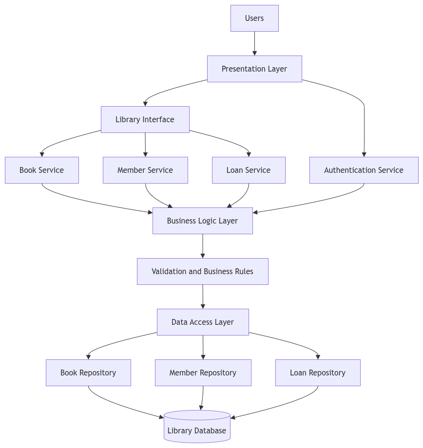
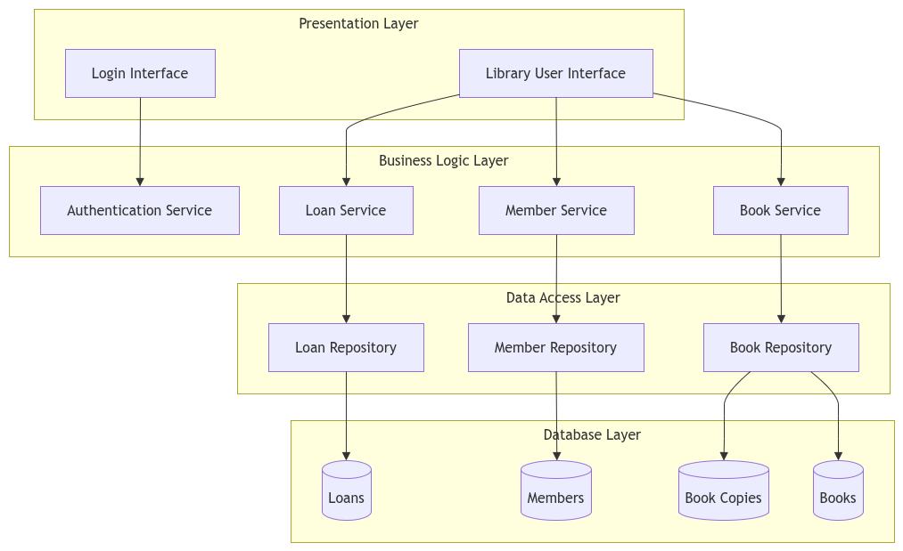
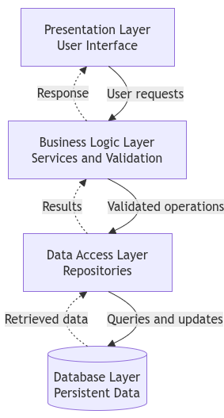

# System Architecture

## 1. Architecture Overview

The Library Management System (LMS) follows a **layered architecture**. Each layer has a specific responsibility, making the system easier to maintain, test, and extend.

The system is divided into four main layers:

1. **Presentation Layer:** Provides the user interface through which librarians and members interact with the system.
2. **Business Logic Layer:** Handles the main operations and business rules, such as borrowing books, returning books, and managing members.
3. **Data Access Layer:** Communicates with the database through repositories and handles data retrieval and storage.
4. **Database Layer:** Stores information about books, physical book copies, members, librarians, and loans.

## 2. Architecture Diagram

The following diagram illustrates the main components and how they communicate with each other.

## 2.1 Component Diagram

This diagram presents the main software components of the Library Management System and their relationships.

The component diagram illustrates how the system is divided into independent components. Each service communicates with its corresponding repository, which handles database operations.

## 2.2 Layered Architecture Diagram

The following diagram provides a simplified view of the four architectural layers and the direction of communication between them.

The solid arrows represent requests moving toward the database. The dashed arrows represent results returning to the user interface.

## 3. Main Architectural Components

### 3.1 Presentation Layer

The Presentation Layer is responsible for user interaction.

It allows librarians and members to access the system's features through an interface.

**Main responsibilities:**

- Display available books.
- Allow users to search for books.
- Display member information.
- Allow librarians to manage books and members.
- Provide borrowing and returning options.
- Display loan information and due dates.

### 3.2 Business Logic Layer

The Business Logic Layer contains the main operations and rules of the Library Management System.

It ensures that operations follow the library's policies before any data is changed.

**Main components:**

- **Book Service:** Manages book-related operations, including adding, updating, and searching for books.
- **Member Service:** Handles member registration and member information.
- **Loan Service:** Manages borrowing and returning operations.
- **Authentication Service:** Handles user authentication and access control.
- **Validation:** Checks business rules, such as book availability and borrowing limits.

**Example business rules:**

- A member cannot borrow a book if no copy is available.
- A member cannot exceed the maximum borrowing limit.
- Only authorized librarians can add or remove books.
- A book copy must be marked as issued when borrowed.
- A returned book copy becomes available again, unless it requires maintenance.

### 3.3 Data Access Layer

The Data Access Layer is responsible for communication between the Business Logic Layer and the database.

It uses the Repository Pattern to organize database operations.

**Main repositories:**

- **Book Repository:** Retrieves and stores book information.
- **Member Repository:** Retrieves and stores member information.
- **Loan Repository:** Retrieves and stores borrowing and returning records.

This layer separates database operations from business logic, making the application easier to maintain and test.

### 3.4 Database Layer

The Database Layer stores all persistent information required by the system.

The main entities include:

- **Book:** Stores general information about a book, such as its title, author, ISBN, and category.
- **BookCopy:** Represents an individual physical copy of a book and its availability status.
- **Member:** Stores information about registered library members.
- **Librarian:** Stores information about librarians who manage the library.
- **Loan:** Stores borrowing records, including borrowing dates, due dates, and return dates.

A Book can have multiple BookCopy records because a library may own several physical copies of the same title.

## 4. Communication Between Layers

The system follows a structured communication flow:

1. A user performs an action through the Presentation Layer.
2. The Presentation Layer sends the request to the appropriate service in the Business Logic Layer.
3. The Business Logic Layer validates the request and checks the relevant business rules.
4. If the request is valid, the service communicates with the appropriate repository.
5. The repository retrieves or updates the required information in the database.
6. The result is returned through the layers to the Presentation Layer.
7. The interface displays the result to the user.

This separation ensures that each layer focuses on its own responsibilities.

## 5. Example: Borrowing a Book

The following workflow describes how the system processes a book borrowing request.

1. A member selects an available book copy.
2. The Presentation Layer sends the borrowing request to the Loan Service.
3. The Loan Service checks whether the member is registered and allowed to borrow another book.
4. The service checks whether the selected book copy is available.
5. If all conditions are satisfied, a new Loan record is created.
6. The BookCopy status changes from `AVAILABLE` to `ISSUED`.
7. The updated information is saved through the repositories.
8. The system confirms that the borrowing operation was successful.

If any validation fails, the system rejects the request and displays an appropriate message.

## 6. Architectural Design Principles

The architecture follows several software design principles:

- **Separation of Concerns:** Each layer has a clearly defined responsibility.
- **Single Responsibility Principle (SRP):** Each service and repository focuses on a specific task.
- **Encapsulation:** Internal object data is managed through controlled methods.
- **Maintainability:** Changes to one layer should have minimal impact on other layers.
- **Reusability:** Services and repositories can be reused by different parts of the system.
- **Scalability:** The layered structure allows new features to be added without redesigning the entire system.

## 7. Conclusion

The proposed layered architecture provides a clear organization for the Library Management System.

By separating presentation, business logic, data access, and database responsibilities, the system becomes easier to understand, maintain, test, and extend.

This architecture provides a foundation for implementing the main library operations while keeping the system modular and organized.
