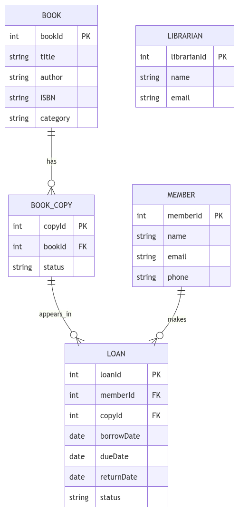
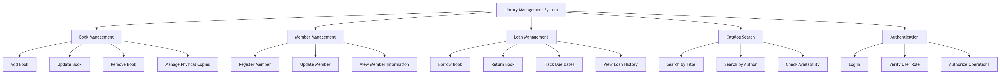
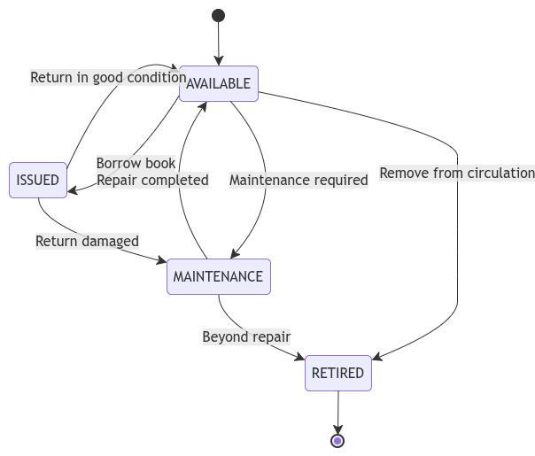
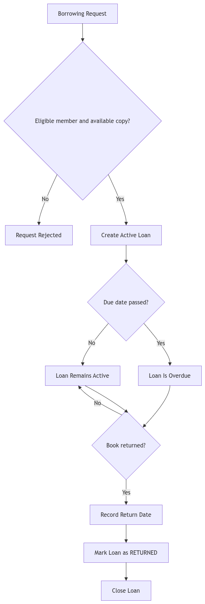

# Data, Functional, and Behavioral Models

## 1. Introduction

This document describes the data structure, main functions, and behavior of the Library Management System (LMS).

It includes three important models:

- **Data Model:** Defines the information stored by the system and the relationships between entities.
- **Functional Model:** Describes the main operations and how the system's functionality is organized.
- **Behavioral Model:** Explains how the system behaves in response to user actions and how objects change their states over time.

These models complement the UML diagrams and provide a more complete understanding of the system before implementation.

---

## 2. Data Model

### 2.1 Overview

The data model identifies the main entities required by the Library Management System, their attributes, and their relationships.

The system uses five main entities:

1. **Book:** Represents a book title in the library catalog.
2. **BookCopy:** Represents an individual physical copy of a book.
3. **Member:** Represents a registered library member.
4. **Librarian:** Represents a staff member responsible for library operations.
5. **Loan:** Represents a borrowing transaction.

Separating `Book` and `BookCopy` allows the library to manage multiple physical copies of the same title independently.

### 2.2 Entities and Attributes

#### Book

Stores general information about a book.

| Attribute   | Description                        |
| ----------- | ---------------------------------- |
| bookId (PK) | Unique identifier for the book     |
| title       | Book title                         |
| author      | Book author                        |
| ISBN        | International Standard Book Number |
| category    | Book category or genre             |

#### BookCopy

Represents one physical copy of a book.

| Attribute   | Description                             |
| ----------- | --------------------------------------- |
| copyId (PK) | Unique identifier for the physical copy |
| bookId (FK) | Reference to the associated book        |
| status      | Current availability status             |

Possible statuses:

- `AVAILABLE`
- `ISSUED`
- `MAINTENANCE`
- `RETIRED`

#### Member

Stores information about registered library members.

| Attribute     | Description              |
| ------------- | ------------------------ |
| memberId (PK) | Unique member identifier |
| name          | Member's full name       |
| email         | Member's email address   |
| phone         | Member's phone number    |

#### Librarian

Stores information about library staff.

| Attribute        | Description                 |
| ---------------- | --------------------------- |
| librarianId (PK) | Unique librarian identifier |
| name             | Librarian's full name       |
| email            | Librarian's email address   |

#### Loan

Stores information about borrowing transactions.

| Attribute     | Description                                 |
| ------------- | ------------------------------------------- |
| loanId (PK)   | Unique loan identifier                      |
| memberId (FK) | Reference to the borrowing member           |
| copyId (FK)   | Reference to the borrowed physical copy     |
| borrowDate    | Date the book was borrowed                  |
| dueDate       | Expected return date                        |
| returnDate    | Actual return date; nullable until returned |
| status        | Current loan status                         |

Possible statuses:

- `ACTIVE`
- `RETURNED`

A loan is considered overdue when its status is `ACTIVE` and its due date has passed.

### 2.3 Entity-Relationship Diagram (ERD)

The following ERD illustrates the entities, their attributes, primary keys, foreign keys, and relationships.

### 2.4 Relationship Explanation

- One `Book` can have zero or many `BookCopy` records.
- Each `BookCopy` belongs to exactly one `Book`.
- One `Member` can have zero or many `Loan` records.
- Each `Loan` belongs to exactly one `Member`.
- One `BookCopy` can appear in multiple historical `Loan` records.
- Each `Loan` refers to exactly one `BookCopy`.
- A physical book copy can have only one active loan at a time.

The `Librarian` entity stores staff information. Librarians manage catalog and member operations through the application. Their actions could also be recorded in an audit log in a future version.

### 2.5 Data Integrity Rules

The database should enforce the following rules:

1. Every entity must have a unique primary key.
2. Foreign keys must reference existing records.
3. A book copy must belong to an existing book.
4. A loan must reference an existing member and book copy.
5. A book copy cannot have multiple active loans simultaneously.
6. A returned loan must have a recorded return date.
7. The return date cannot be earlier than the borrowing date.
8. A retired book copy cannot be borrowed.

These constraints help maintain data consistency and prevent invalid operations.

---

## 3. Functional Model

### 3.1 Overview

The functional model describes what the Library Management System does.

It decomposes the system into smaller functions, each responsible for a specific operation.

The main functional areas are:

- Book Management
- Member Management
- Loan Management
- Catalog Search
- Authentication and Access Control

### 3.2 Functional Decomposition Diagram

The following diagram shows the hierarchical organization of the system's main functions.

### 3.3 Main Functional Descriptions

**Book Management**

Allows librarians to:

- Add new book titles.
- Update book information.
- Remove books from the catalog.
- Add and manage physical copies.

**Member Management**

Allows librarians to:

- Register new members.
- Update member information.
- View member details.

**Loan Management**

Handles:

- Borrowing available book copies.
- Returning borrowed books.
- Tracking loan due dates.
- Displaying borrowing history.

**Catalog Search**

Allows users to:

- Search books by title.
- Search books by author.
- Check book availability.

**Authentication and Access Control**

Ensures that:

- Users can log in.
- User roles are identified.
- Only authorized users can perform restricted operations.

---

## 4. Behavioral Model

### 4.1 Overview

The behavioral model describes how the system responds to events and how its objects change over time.

It focuses on the lifecycle of book copies and loans.

The model ensures that operations such as borrowing and returning follow valid transitions.

### 4.2 BookCopy Lifecycle

A physical book copy can have four main states:

| State       | Description                                                   |
| ----------- | ------------------------------------------------------------- |
| AVAILABLE   | The copy can be borrowed.                                     |
| ISSUED      | The copy is currently borrowed.                               |
| MAINTENANCE | The copy is temporarily unavailable for repair or inspection. |
| RETIRED     | The copy has been permanently removed from circulation.       |

The lifecycle is represented in the following diagram.

### 4.3 Loan Lifecycle

A loan represents the borrowing relationship between a member and a physical book copy.

Its lifecycle contains the following stages:

1. **Created:** A borrowing request is validated and a loan is created.
2. **Active:** The member currently has the book.
3. **Overdue:** The due date has passed and the loan has not been returned. This is a condition of an active loan, not a separate stored status.
4. **Returned:** The member returns the book and the loan is closed.

### 4.4 System Events and Responses

| Event                            | System response                                   |
| -------------------------------- | ------------------------------------------------- |
| Member searches for a book       | The system displays matching books.               |
| Member requests to borrow a book | The system checks eligibility and availability.   |
| Borrowing is successful          | A loan is created and the copy becomes issued.    |
| Member returns a book            | The system updates the loan and copy status.      |
| A due date passes                | The system identifies the active loan as overdue. |
| Librarian adds a book            | The catalog is updated.                           |
| Librarian registers a member     | A new member record is created.                   |

### 4.5 Behavioral Rules

The system must respect the following rules:

- Only available book copies can be borrowed.
- A member must be registered and eligible to borrow books.
- A member cannot exceed the maximum borrowing limit.
- An active loan must be closed when the book is returned.
- A returned book copy becomes available only if it is in acceptable condition.
- A retired book copy cannot be borrowed.
- An overdue loan remains active until the book is returned.

---

## 5. Relationship Between the Three Models

The data, functional, and behavioral models describe different aspects of the same system.

| Model            | Main question                            | Focus                               |
| ---------------- | ---------------------------------------- | ----------------------------------- |
| Data Model       | What information does the system store?  | Entities, attributes, relationships |
| Functional Model | What operations does the system perform? | Functions and responsibilities      |
| Behavioral Model | How does the system respond to events?   | States, transitions, and workflows  |

For example, when a member borrows a book:

- The **Data Model** identifies the Member, BookCopy, and Loan entities involved.
- The **Functional Model** identifies the Borrow Book operation.
- The **Behavioral Model** describes how the book copy changes from `AVAILABLE` to `ISSUED`.

Together, these models provide a consistent representation of the system.

## 6. Conclusion

The data, functional, and behavioral models define the information, operations, and dynamic behavior of the Library Management System.

They complement the architecture and UML diagrams by providing a more detailed understanding of how the system is organized and how its main operations work.

These models establish a foundation for implementation while helping ensure data consistency, clear responsibilities, and valid system behavior.
