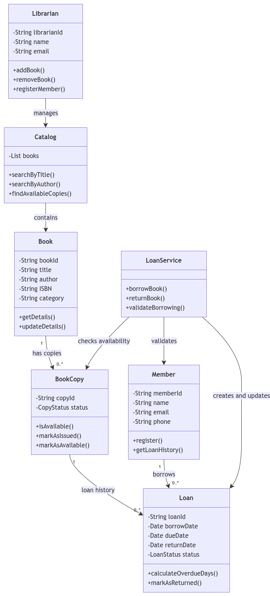
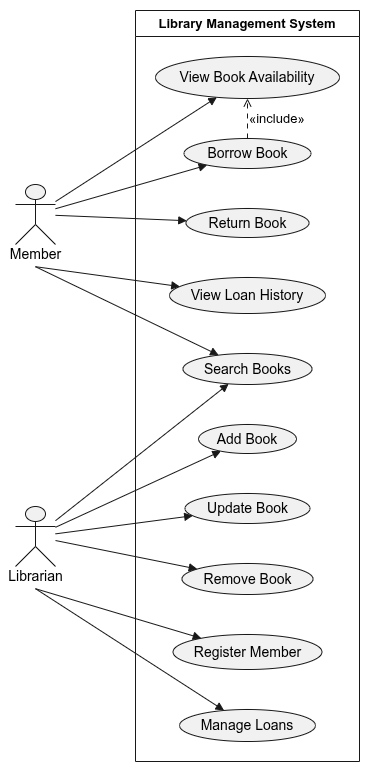
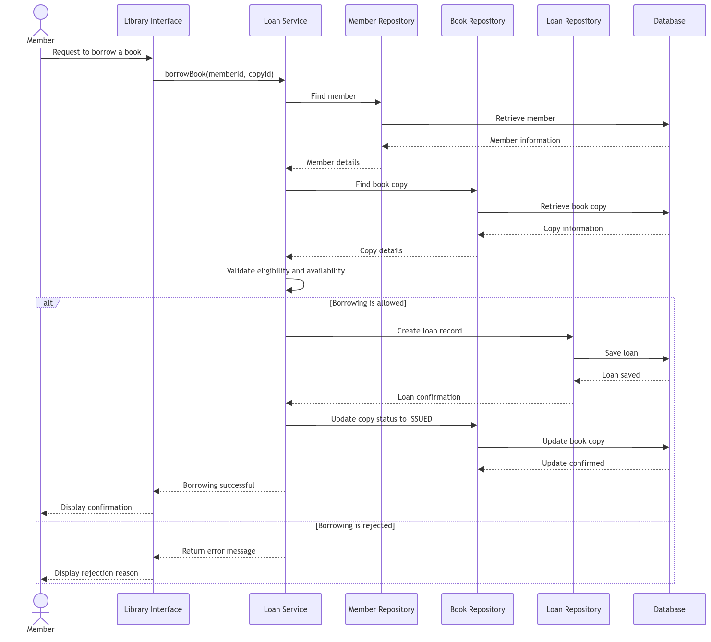
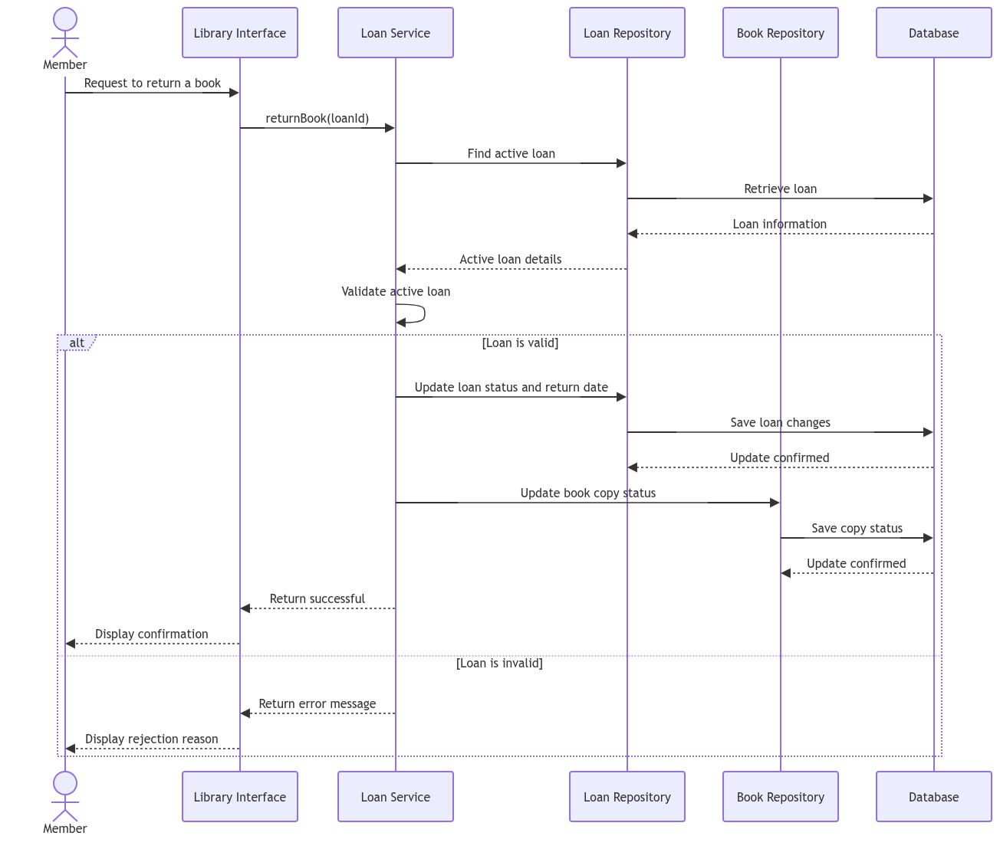
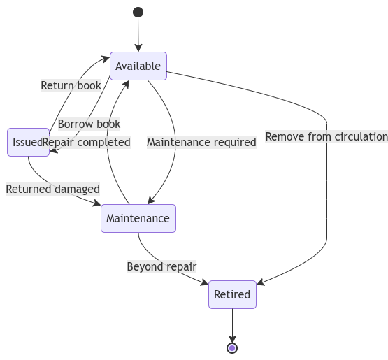

# UML Diagrams

## 1. Introduction

Unified Modeling Language (UML) is used to visualize the structure and behavior of the Library Management System (LMS).

The following diagrams describe the main classes, system interactions, workflows, and object states.

This document includes:

- Class Diagram
- Use Case Diagram
- Sequence Diagram: Borrow a Book
- Sequence Diagram: Return a Book
- State Diagram: Book Copy Lifecycle

## 2. Class Diagram

### 2.1 Main Classes

The system is designed around the following classes:

| Class       | Description                                               |
| ----------- | --------------------------------------------------------- |
| Book        | Represents a book title in the library catalog.           |
| BookCopy    | Represents an individual physical copy of a book.         |
| Member      | Represents a registered library member.                   |
| Librarian   | Represents a staff member who manages library operations. |
| Loan        | Represents a borrowing transaction.                       |
| Catalog     | Manages the collection of books.                          |
| LoanService | Handles borrowing and returning operations.               |

### 2.2 Class Attributes and Methods

**Book**

- Attributes: `bookId`, `title`, `author`, `ISBN`, `category`
- Methods: `getDetails()`, `updateDetails()`

**BookCopy**

- Attributes: `copyId`, `status`, `book`
- Methods: `isAvailable()`, `markAsIssued()`, `markAsAvailable()`

**Member**

- Attributes: `memberId`, `name`, `email`, `phone`
- Methods: `register()`, `getLoanHistory()`

**Librarian**

- Attributes: `librarianId`, `name`, `email`
- Methods: `addBook()`, `removeBook()`, `registerMember()`

**Loan**

- Attributes: `loanId`, `borrowDate`, `dueDate`, `returnDate`, `status`
- Methods: `calculateOverdueDays()`, `markAsReturned()`

**Catalog**

- Attributes: `books`
- Methods: `searchByTitle()`, `searchByAuthor()`, `findAvailableCopies()`

**LoanService**

- Methods: `borrowBook()`, `returnBook()`, `validateBorrowing()`

### 2.3 Class Diagram Visualization

The class diagram illustrates the main classes, their attributes, methods, and relationships.

### 2.4 Class Relationships

- One `Book` can have multiple `BookCopy` objects.
- One `Member` can have multiple `Loan` records over time.
- One `BookCopy` can be associated with multiple historical loans, but only one active loan at a time.
- A `Librarian` manages the catalog and performs administrative operations.
- `LoanService` coordinates borrowing and returning operations.

The distinction between `Book` and `BookCopy` is important: a book represents a title, while a book copy represents a physical item that can be borrowed.

## 3. Use Case Diagram

### 3.1 Actors

The system has two primary actors:

**Member**

- Search for books.
- View book availability.
- Borrow available books.
- Return borrowed books.
- View personal loan history.

**Librarian**

- Add books to the catalog.
- Update book information.
- Remove books from the catalog.
- Register members.
- Manage book loans.

### 3.2 Use Case Diagram Visualization

The following diagram shows the interactions between the actors and the Library Management System.

### 3.3 Use Case Description: Borrow a Book

**Primary actor:** Member

**Preconditions:**

- The member is registered.
- The member is allowed to borrow books.
- At least one copy of the selected book is available.

**Main flow:**

1. The member searches for a book.
2. The system displays matching books and their availability.
3. The member selects an available book copy.
4. The system validates the member's borrowing eligibility.
5. The system creates a loan record.
6. The selected copy is marked as issued.
7. The system confirms the borrowing operation.

**Alternative flow:**

- If no copy is available, the system informs the member.
- If the member has reached the borrowing limit, the request is rejected.

**Postcondition:**

- A new active loan exists.
- The selected book copy is marked as issued.

### 3.4 Use Case Description: Return a Book

**Primary actor:** Member

**Preconditions:**

- The member has an active loan.
- The borrowed book copy has not already been returned.

**Main flow:**

1. The member presents the borrowed book.
2. The system identifies the active loan.
3. The system records the return date.
4. The loan status changes to returned.
5. The book copy becomes available, unless maintenance is required.
6. The system confirms the return.

**Postcondition:**

- The loan is marked as returned.
- The book copy is available or marked for maintenance.

## 4. Sequence Diagram: Borrow a Book

### 4.1 Description

This sequence diagram illustrates the interactions between the member, user interface, Loan Service, repositories, and database when a member borrows a book.

### 4.2 Sequence Diagram Visualization

### 4.3 Explanation

The Loan Service coordinates the borrowing process.

It first retrieves the member and book copy information, then checks whether the borrowing operation is allowed.

If the validation succeeds, the system creates a loan record and updates the book copy status. Otherwise, the request is rejected.

In a real implementation, creating the loan and updating the copy status should happen within one database transaction to prevent inconsistent data.

## 5. Sequence Diagram: Return a Book

### 5.1 Description

This sequence diagram illustrates how the system processes a book return.

### 5.2 Sequence Diagram Visualization

### 5.3 Explanation

The Loan Service retrieves the loan record and checks whether it is still active.

If the loan is valid, the system records the return date and changes the loan status to `RETURNED`.

The associated book copy is then marked as `AVAILABLE`, unless it needs maintenance.

If the loan does not exist or has already been returned, the system rejects the operation.

## 6. State Diagram: Book Copy Lifecycle

### 6.1 Description

The state diagram represents the different states of an individual physical book copy during its lifecycle.

The main states are:

- `AVAILABLE`: The copy is available for borrowing.
- `ISSUED`: The copy is currently borrowed by a member.
- `MAINTENANCE`: The copy is temporarily unavailable because it needs repair or inspection.
- `RETIRED`: The copy has been permanently removed from circulation.

### 6.2 State Diagram Visualization

### 6.3 Explanation

A new book copy starts in the `AVAILABLE` state.

When a member borrows it, the copy transitions to `ISSUED`.

When the book is returned in good condition, it becomes `AVAILABLE` again.

If the book is damaged or requires inspection, it moves to `MAINTENANCE`. After repair, it can become available again.

A copy that is permanently removed from circulation enters the `RETIRED` state.

The state diagram helps define valid transitions and prevents incorrect operations, such as borrowing a copy that is already issued or retired.

## 7. Conclusion

The UML diagrams provide complementary views of the Library Management System.

- The **Class Diagram** describes the static structure of the system.
- The **Use Case Diagram** identifies the actors and their interactions with the system.
- The **Sequence Diagrams** describe the steps involved in borrowing and returning books.
- The **State Diagram** describes the lifecycle of a physical book copy.

Together, these diagrams provide a clear model of the system's structure, functionality, and behavior before implementation.
